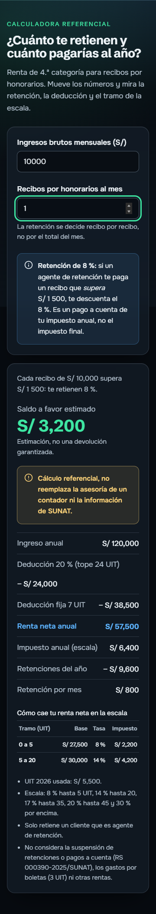

# Kipuflow (demo de portafolio, Vélez De Villa)

SaaS ficticio de finanzas para freelancers peruanos. Astro estático, CSS propio, JS mínimo en islas.

Muestra: calculadora referencial de renta de 4.ª categoría (retención 8 %, deducciones, escala), precios mensual/anual, bento de funciones, testimonios «Ejemplo de demo», FAQ con `<details>` y formulario de acceso anticipado que termina en wa.me o confirmación demo.

## Correr
```
npm install
npm run dev        # http://localhost:4331
npm run build && npm run preview
npm test           # vitest: función de cálculo
node scripts/capturas.mjs   # requiere preview en 4331 y Edge instalado
```

## Capturas
`capturas/` (320, 360, 768 y 1440): inicio, calculadora, precios anuales y Libro de Reclamaciones de demo.

| | |
|---|---|
|  |  |
| Inicio en escritorio | Calculadora en celular |

Cálculo referencial, no reemplaza la asesoría de un contador ni la información de SUNAT. Ver DECISIONES.md y CREDITOS.md.
