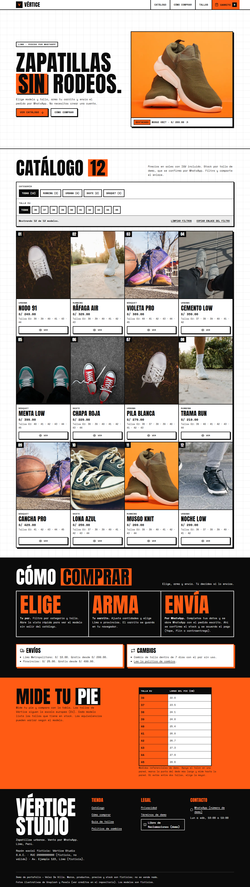
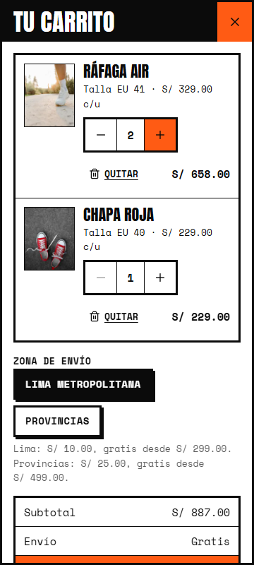
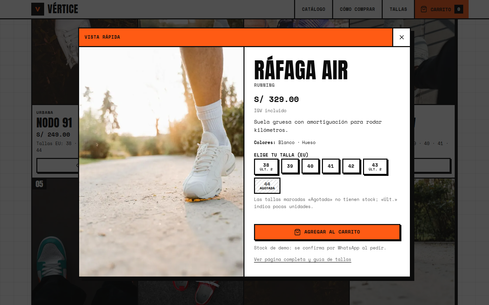

# Vértice Studio (demo)

Tienda ficticia de zapatillas urbanas en Lima que vende por WhatsApp. Demo de portafolio de **Vélez De Villa** (sistemas y automatización para negocios). Estética brutalista en blanco, negro y naranja.

> Marca, productos, precios, stock, RUC y teléfono son ficticios. No se vende nada.

## Qué muestra
- Catálogo de 12 productos ficticios (fotos ilustrativas sin logos) con **filtro por categoría y talla** (accesible, conteo en `aria-live`, URL compartible `?categoria=skate&talla=41`). Sin JS se ve completo.
- **Vista rápida** en `<dialog>` modal, con foco atrapado, Escape, retorno de foco y talla obligatoria.
- **Carrito lateral** persistido en `localStorage`, con cantidades, quitar, subtotal en S/, envío Lima/provincias y **pedido por WhatsApp** (formulario validado en español que arma el mensaje `wa.me`).
- Página de producto estática `/producto/[slug]/` con guía de tallas y JSON-LD `Product`/`Offer` (más `Store` en el inicio).
- Privacidad (con consentimiento expreso y aviso de WhatsApp/Meta), Términos de demo, política de cambios y **Libro de Reclamaciones de demo** completo con número de hoja y constancia imprimible (sin envío real).

## Stack
Astro 7 (estático) · CSS propio · JS mínimo en islas (TypeScript) · sin Tailwind · Anton y Space Mono autohospedadas · Lucide · imágenes WebP con `astro:assets`.

## Correr
```bash
npm install
npm run dev        # http://localhost:4332
npm run build
npm run preview    # http://localhost:4332
npm test           # Vitest: carrito, envío, persistencia, mensaje de WhatsApp, validación, filtros
node scripts/og.mjs        # regenera public/og.png (Playwright + Edge)
node scripts/capturas.mjs  # capturas a 360, 768 y 1440 (requiere npm run preview)
```

## Diseño
Pulido 2026-11: se mantiene la identidad brutalista (Anton + Space Mono, naranja y negro, bordes y sombras duras). Cabecera móvil de 55 px, héroe en una pantalla, «Cómo comprar» con palabras grandes ELIGE / ARMA / ENVÍA.

## Capturas
En [`capturas/`](capturas/): inicio, filtro aplicado, vista rápida, aviso al agregar, carrito, formulario, confirmación del pedido y página de producto a 360, 768 y 1440 px.

| | |
|---|---|
|  |  |
| Inicio en escritorio | Carrito en celular |





## Más
[DECISIONES.md](DECISIONES.md) · [CREDITOS.md](CREDITOS.md)
