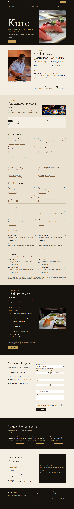

# Kuro · Barranco (demo de portafolio)

Sitio de un restaurante nikkei **ficticio** en Barranco, Lima. Demo de [Vélez De Villa](https://velezdevilla.com) (sistemas y automatización para negocios). Estética editorial en tierra, carbón y dorado.

## Qué muestra
- **Carta filtrable por tiempos** (Para empezar, Tiraditos y ceviches, Nigiris y makis, Fondos, Postres, Barra) y por etiqueta (vegetariano, picante, contiene mariscos, sin gluten). 24 platos ficticios en `src/data/carta.ts`. Sin JavaScript se ve toda la carta.
- **Reserva de mesa y de omakase validadas** (omakase: mar–sáb, 19:00 y 21:30, 48 h de anticipación): fecha desde hoy en hora de Lima, horario real (mar–sáb 12:30–16:00 y 19:00–23:00, dom 12:30–17:00, lunes cerrado, última reserva 1 h antes del cierre), 1 a 8 personas (más: aviso con botón a WhatsApp para grupos), nombre, celular peruano, ocasión, alergias y consentimiento expreso. Termina en confirmación demo y un enlace `wa.me` prellenado.
- Historia del chef ficticio, experiencia omakase (S/ 320), ubicación y horario, testimonios «Ejemplo de demo».
- Privacidad, Términos de demo y **Libro de Reclamaciones de demo** (con número de hoja, sin envío), 404 propia.
- SEO: JSON-LD `Restaurant`, Open Graph 1200×630, `noindex` mientras sea demo.

## Capturas
Carpeta [`capturas/`](capturas): inicio, carta filtrada, reserva con errores y reserva con éxito a 360, 768 y 1440 px.



## Cómo correrlo
```bash
npm install
npm run dev        # http://localhost:4333
npm test           # pruebas de horario, fechas (Lima) y validaciones
npm run build      # genera dist/
npm run preview    # sirve dist/ en el puerto 4333
node scripts/og.mjs        # regenera public/og.png
node scripts/capturas.mjs  # capturas (con el preview activo, usa Edge instalado)
```

## Stack
Astro 7 estático, CSS propio (sin Tailwind), TypeScript en islas mínimas, Vitest, fuentes Cormorant Garamond y Figtree autohospedadas, íconos Lucide. Ver [DECISIONES.md](DECISIONES.md) y [CREDITOS.md](CREDITOS.md).

> Todo el contenido es ficticio: marca, chef, dirección, teléfono, RUC 20000000001 y testimonios.
