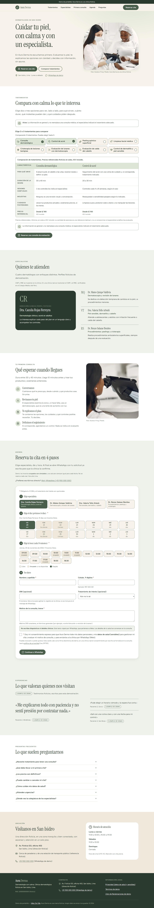
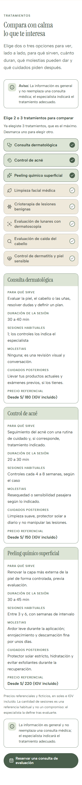

# Aura Derma — demo de portafolio

Clínica dermatológica **ficticia** en San Isidro (Lima), parte del portafolio de Vélez De Villa. Estética calma en salvia, crema y blanco.

## Qué muestra
- **Comparador de tratamientos**: 8 tratamientos ficticios; se eligen 2 o 3 y se compara para qué sirven, duración, sesiones, molestias, cuidados y precio referencial «desde S/». Aviso médico visible.
- **Especialistas** ficticios, sin números de colegiatura inventados («CMP y RNE se muestran en la clínica»).
- **Agenda** de 14 días (America/Lima, domingos cerrados) con especialista y bloques de 30 min; algunos ocupados de forma simulada y determinista. Valida fecha/hora y datos (nombre, celular de 9 dígitos, DNI opcional, motivo, consentimiento Ley 29733) y termina en `wa.me` prellenado más confirmación demo.
- Primera consulta, preguntas frecuentes, ubicación ficticia, testimonios marcados «Ejemplo de demo».
- Privacidad (datos de salud = sensibles), Términos de demo y Libro de Reclamaciones de demo.
- SEO: JSON-LD MedicalClinic/Dermatology ficticio, Open Graph 1200x630 (`public/og.png`), `noindex` mientras sea demo.

## Capturas
`capturas/` contiene inicio, comparador con 3 tratamientos y agenda con ocupados, a 360, 768 y 1440 px.

| | |
|---|---|
|  |  |
| Inicio en escritorio | Comparador en celular |

## Correrlo
```bash
npm install
npm run dev          # http://localhost:4334
npm test             # vitest: horarios y validaciones
npm run build
npm run preview      # sirve dist en 4334
npm run capturas     # requiere preview activo y Edge instalado
npm run og           # regenera public/og.png
```

## Documentos
[CREDITOS.md](CREDITOS.md) · [DECISIONES.md](DECISIONES.md)

Demo de portafolio — Vélez De Villa. Marca, personas, teléfonos y direcciones ficticios.
