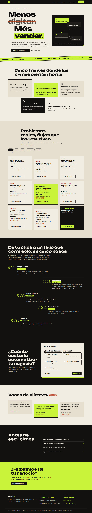
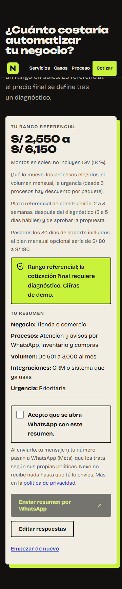

# Nexo Automatiza (demo de portafolio)

Demo de **Vélez De Villa**: sitio de una agencia ficticia de automatización para pymes de Lima (WhatsApp, Google Sheets, facturación, inventario, reportes). Marca, casos, cifras y testimonios son ficticios y llevan la etiqueta «Ejemplo de demo».

## Qué muestra
- Estética **asimétrica**: retícula rota, bloques desplazados, Unbounded + Bricolage Grotesque autohospedadas, paleta tinta / papel / lima.
- **Animación al hacer scroll** con `IntersectionObserver` (sin librerías). Se desactiva con `prefers-reduced-motion` y, sin JS, todo queda visible.
- **Casos** (8) con filtro por sector (conteo en `aria-live`) y modal `<dialog>` con foco atrapado, Escape y retorno de foco.
- **Proceso** en 5 pasos con tiempos referenciales.
- **Cotizador** de 4 pasos con barra de progreso, validación por paso, botón Atrás que conserva respuestas y resultado como rango en S/ que termina en `wa.me` prellenado. Lógica pura en `src/lib/cotizador.ts`, tabla en `src/data/precios.ts`, pruebas en `src/lib/cotizador.test.ts`.
- Páginas `/privacidad/`, `/terminos/`, `/libro-reclamaciones/` (de demo) y `404`.
- SEO: JSON-LD `ProfessionalService` ficticio, Open Graph 1200x630 (`public/og.png`), `noindex` mientras sea demo, CSP estricta en `public/_headers`.

## Cómo correrlo
```
npm install
npm run dev          # http://localhost:4335
npm run build
npm test
npm run preview      # sirve dist en 4335
node scripts/capturas.mjs   # con preview activo; usa Edge instalado
node scripts/og.mjs         # regenera public/og.png
```

## Diseño
Pulido 2026-11: se mantienen la paleta tinta / papel / lima, el titular tachado y las sombras duras. Cabecera móvil de 53 px, héroe que cabe en una pantalla (lista de 4 pasos a 768 px, diagrama en escritorio) y entrada del héroe una sola vez.

## Capturas
En `capturas/`: inicio, casos filtrados con modal, cotizador paso 2 y resultado, a 360, 768 y 1440 px.

| | |
|---|---|
|  |  |
| Inicio en escritorio | Cotizador en celular |

Stack: Astro 7, CSS propio, TypeScript en islas mínimas, Lucide. Sin Tailwind ni frameworks de UI. Ver `DECISIONES.md` y `CREDITOS.md`.
