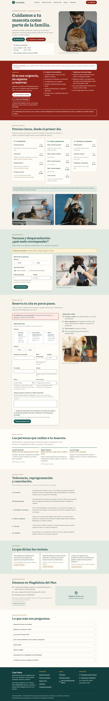
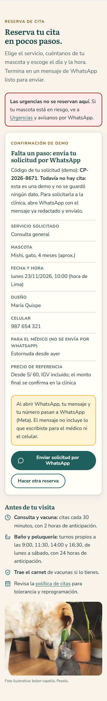

# Casa Patas · demo de portafolio

Sitio de una veterinaria de barrio **ficticia** en Magdalena del Mar (Lima). Demo 11 del portafolio de Vélez De Villa: Astro, CSS propio, JS mínimo en islas, sin Tailwind.

## Qué muestra
- Portada con propuesta, horario visible, «Reservar cita» y «Urgencias por WhatsApp».
- Banda de urgencias accesible: cuándo ir y qué hacer, sin diagnósticos.
- Servicios con precios «desde S/» (IGV incluido), incluido baño y peluquería por tamaño.
- **Guía de vacunación y desparasitación referencial** (perro/gato, por edad o fecha de nacimiento) con aviso grande de que el médico define el esquema. Lógica pura probada con Vitest.
- **Reserva de cita** validada: horario lun-sáb 9:00-20:00 y dom 9:00-13:00 en hora de Lima, turnos propios para baño y peluquería, celular peruano, consentimiento sin marcar, y cierre en confirmación demo + `wa.me` prellenado sin datos sensibles.
- Equipo ficticio (sin CMVP inventados), política de citas, ubicación ficticia y FAQ (sin testimonios: no se inventan opiniones).
- Privacidad, Términos de demo y Libro de Reclamaciones (DS 011-2011-PCM) con constancia imprimible.

## Diseño
Verde azulado, mostaza y crema; títulos en Literata y texto en Nunito Sans (autohospedadas). Detalles y decisiones en [DECISIONES.md](DECISIONES.md); fotos y licencias en [CREDITOS.md](CREDITOS.md).

## Capturas
En `capturas/` a 360, 768 y 1440 px: inicio, urgencias, guía de vacunas, reserva con error y reserva con éxito.




## Correrlo
```
npm install
npm run dev        # http://localhost:4341
npm run build
npm test           # Vitest: horarios, validaciones y guía de vacunación
npm run preview    # y en otra terminal: npm run capturas
node scripts/og.mjs   # regenera public/og.png (usa el Edge instalado)
```
Las capturas y la imagen Open Graph usan `playwright-core` con el Edge instalado (`channel: 'msedge'`); no se descargan navegadores.

## Aviso
Demo de portafolio: no presta servicios veterinarios. La guía de vacunación es referencial y no reemplaza al médico.
