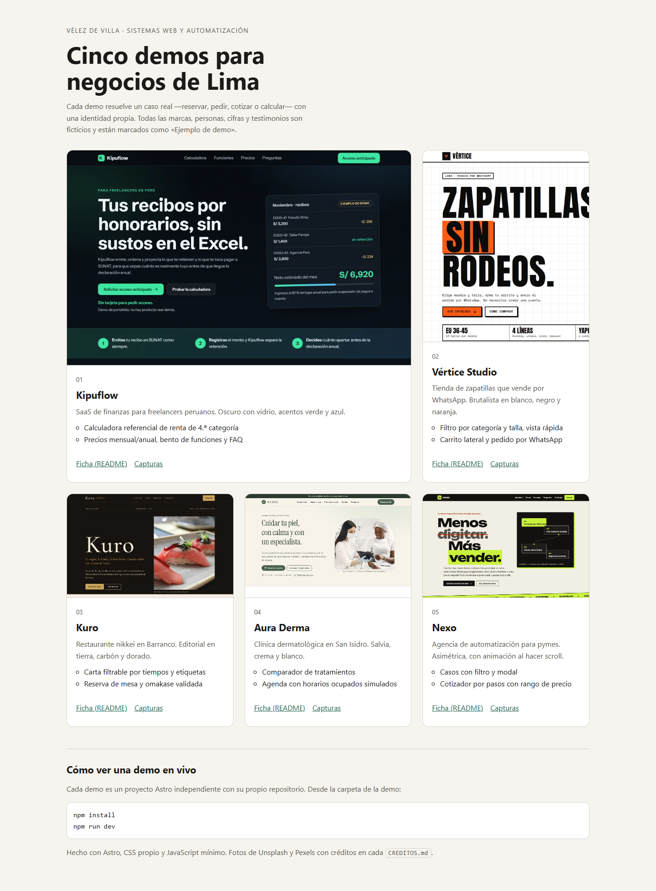
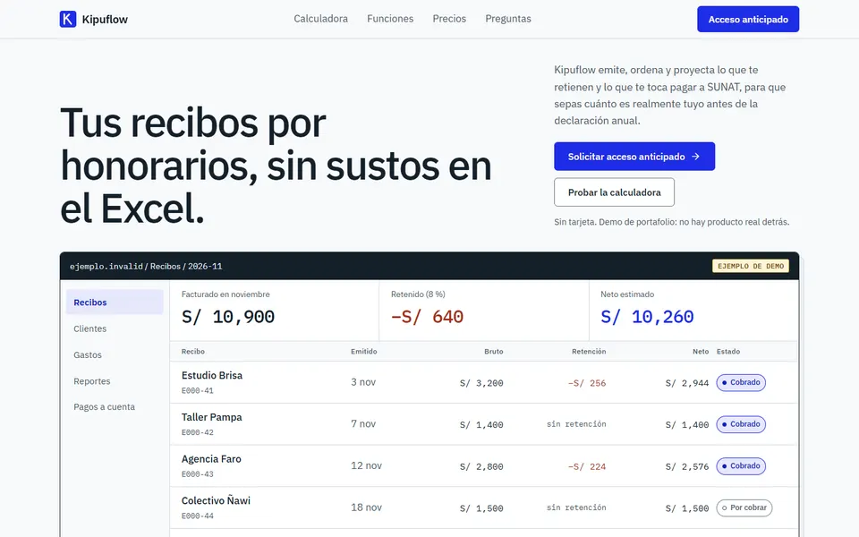
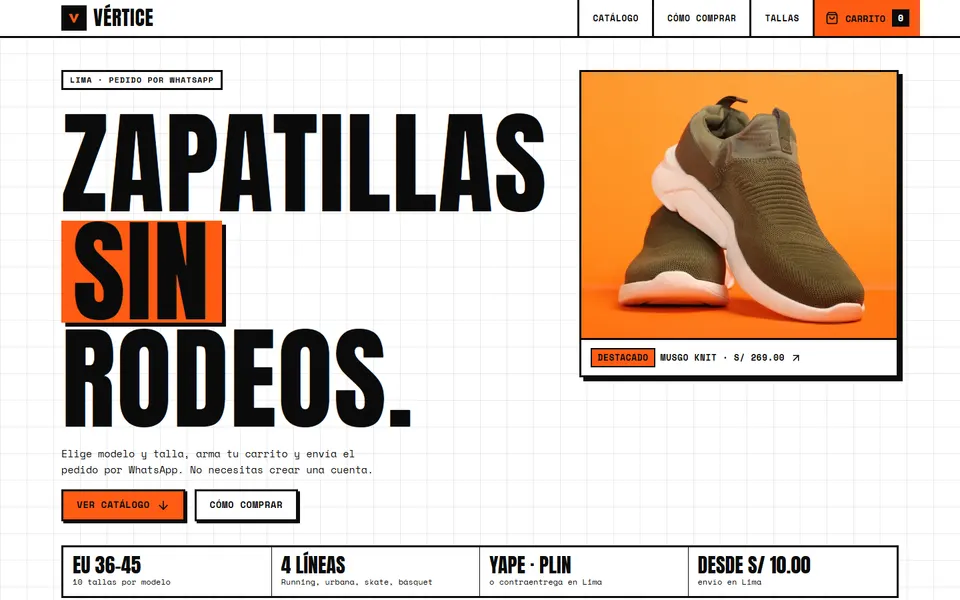
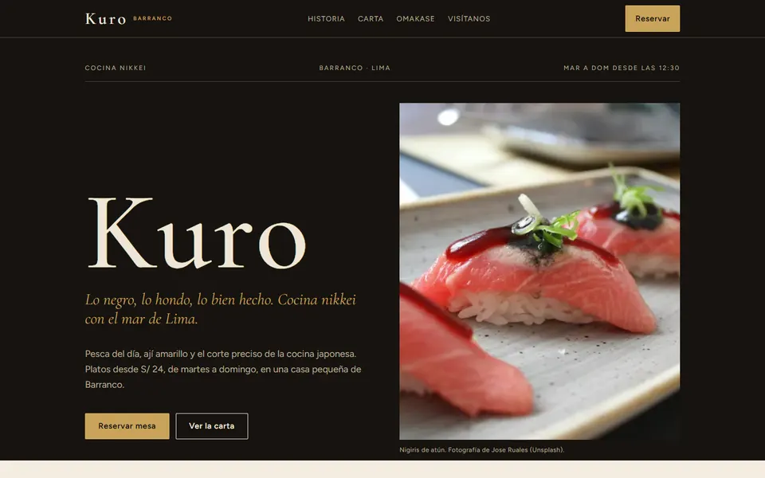
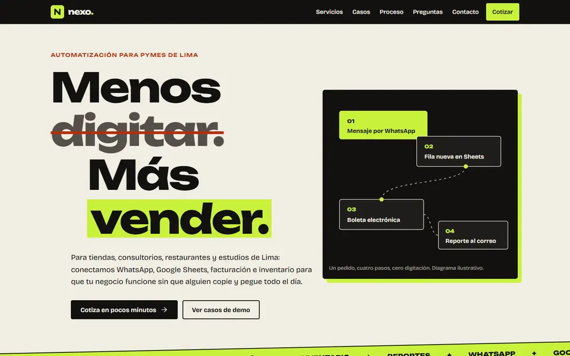
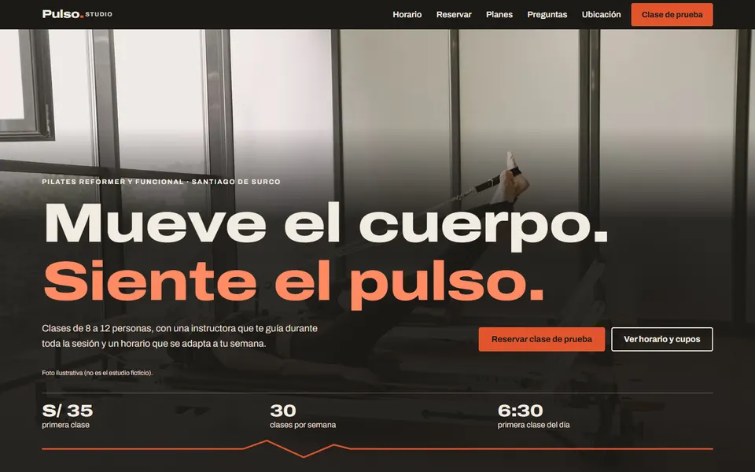
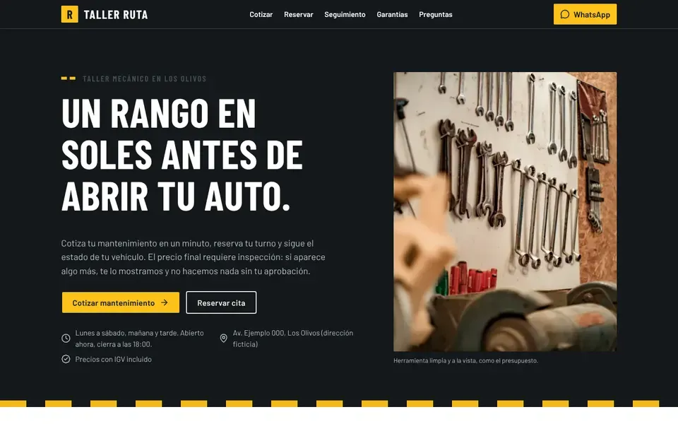
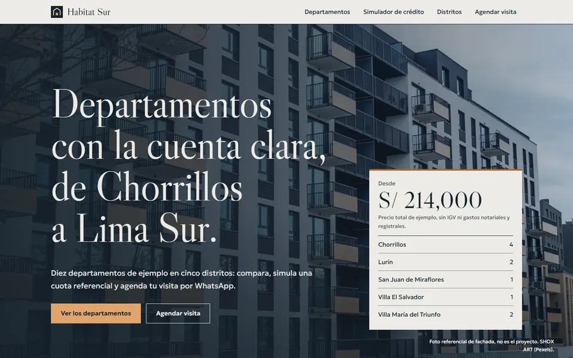
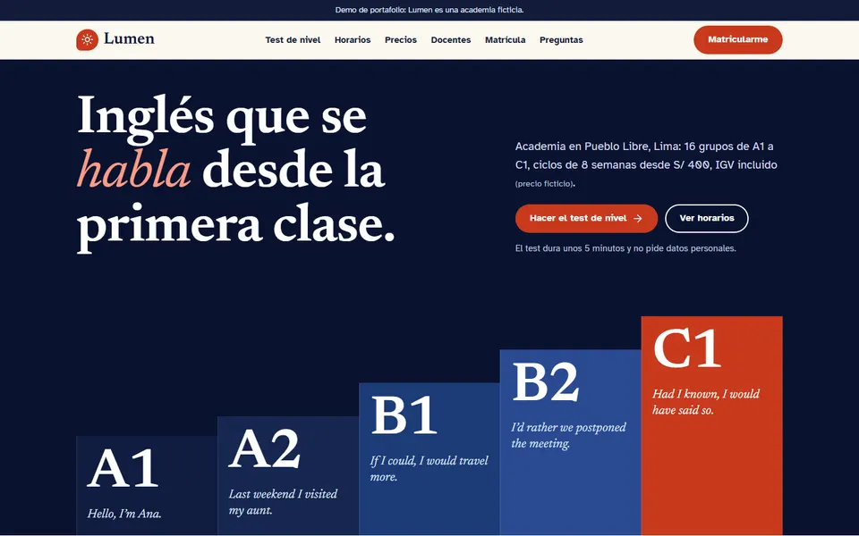

# Demos de portafolio · Vélez De Villa

**[Vélez De Villa](https://velezdevilla.com)** · Sistemas y automatización para negocios en Lima.

Nueve sitios de ejemplo con **marcas ficticias**, hechos para mostrar cómo trabajo: rápidos en celular, accesibles (WCAG 2.2 AA), con SEO local, textos legales de Perú (Ley 29733, Libro de Reclamaciones) y formularios que terminan en WhatsApp. Ningún negocio, persona, precio ni testimonio es real.

**Verlas en vivo:** [velezdevilla.com/demos](https://velezdevilla.com/demos/) (cada demo en `velezdevilla.com/portafolio/<demo>/`; se construyen con `node scripts/publicar.mjs`).



| Demo | Caso | Lo que muestra |
|---|---|---|
| [Kipuflow](01-kipuflow) | SaaS de finanzas para freelancers | Calculadora referencial de renta de 4.ª categoría, precios mensual/anual, FAQ |
| [Vértice Studio](02-vertice-studio) | Tienda de zapatillas | Filtro por categoría y talla, vista rápida, carrito y pedido por WhatsApp |
| [Kuro](03-kuro-lima) | Restaurante nikkei en Barranco | Carta filtrable, reserva de mesa y omakase con horario de Lima |
| [Aura Derma](04-aura-derma) | Clínica dermatológica | Comparador de tratamientos y agenda con horarios ocupados |
| [Nexo Automatiza](05-nexo-automatiza) | Agencia de automatización | Casos con filtro y modal, cotizador por pasos con rango en S/ |
| [Pulso Studio](06-pulso-studio) | Estudio de pilates en Surco | Horario con filtros y cupos, reserva de clase, planes y paquetes en S/ |
| [Taller Ruta](08-taller-ruta) | Taller mecánico en Los Olivos | Cotizador por pasos con rango en S/, reserva por turnos, seguimiento de ejemplo |
| [Habitat Sur](09-habitat-sur) | Inmobiliaria en Lima Sur | 10 departamentos con filtros, ficha con plano, simulador hipotecario, agenda de visita |
| [Lumen](10-lumen-idiomas) | Academia de inglés en Pueblo Libre | Test de nivel A1–C1, horarios con vacantes, matrícula con apoderado para menores |

| | | |
|---|---|---|
|  |  |  |
|  |  |  |
|  |  |  |

## Cómo están hechas

Astro 7 estático, CSS propio y JavaScript mínimo en islas (sin Tailwind), fuentes autohospedadas, íconos Lucide, fotos de Unsplash/Pexels con crédito (nada generado por IA), pruebas con Vitest y cabeceras de seguridad para Cloudflare Pages. Las reglas comunes están en [CONVENCIONES.md](CONVENCIONES.md) y el estado general en [RESUMEN.md](RESUMEN.md).

## Correr una demo

Requisitos: Node.js 20 o superior.

```bash
cd 01-kipuflow        # o la demo que quieras
npm install
npm run dev           # puertos 4331 a 4341, uno por demo
npm test
npm run build
```

## Licencia

Código y diseño de Vélez De Villa, todos los derechos reservados (ver [LICENSE](LICENSE)). Fuentes, íconos y fotos de terceros conservan su licencia, indicada en cada `CREDITOS.md`.
